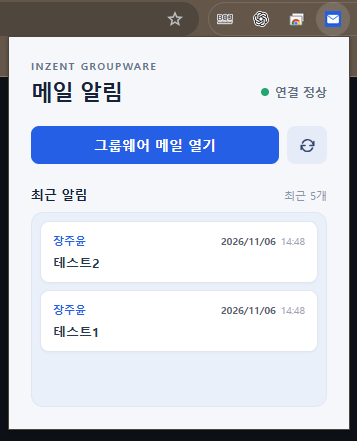
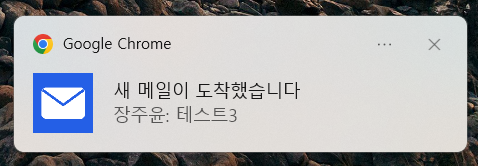

# 인젠트 그룹웨어 메일 알림

크롬에서 그룹웨어 새 메일을 약 1분마다 확인하고 Windows 알림과 확장프로그램 배지로 알려주는 확장프로그램이다. 현재 버전은 **0.1.9**이다.

## 처음 설치하기

1. [Releases](https://github.com/Jang4360/Groupware_Alarm/releases)에서 원하는 버전의 `groupware-alarm-v버전.zip`을 내려받아 압축을 푼다. Releases가 없다면 저장소의 **Code → Download ZIP**으로 받아 압축을 푼다.
2. 크롬 주소창에 `chrome://extensions`를 입력하고 오른쪽 위 **개발자 모드**를 켠다.
3. **압축해제된 확장 프로그램을 로드합니다**를 누르고 압축을 푼 폴더 중 `manifest.json`이 있는 폴더를 선택한다.
4. 같은 크롬 프로필에서 그룹웨어에 로그인하고, 확장프로그램 아이콘을 눌러 **연결 정상**을 확인한다.
5. 크롬의 퍼즐 아이콘에서 확장프로그램을 고정하고 테스트 메일을 받아 알림을 확인한다.

설치 폴더를 이동하거나 삭제하면 확장프로그램을 다시 불러와야 한다. 최초 확인 시에는 기존 메일을 기준으로 저장하며, 이후 도착한 메일부터 알린다.

## 기존 버전 교체하기

1. [Releases](https://github.com/Jang4360/Groupware_Alarm/releases)에서 새 버전 ZIP을 내려받아 별도 폴더에 압축을 푼다.
2. 기존 확장프로그램을 삭제하고  **압축해제된 확장 프로그램을 로드합니다**를 누르고 새 버전 파일을 선택한다. `manifest.json`이 기존 폴더에 바로 위치해야 한다.
3. `chrome://extensions`에서 **인젠트 메일 알림**의 새로고침 버튼을 누르고 연결 상태를 확인한다.

같은 폴더를 유지하고 새로고침하면 기존 설정과 알림 기록을 보존할 수 있다. 확장프로그램을 삭제한 후 다시 설치하면 저장된 기록과 설정이 초기화될 수 있다. 개발자 모드로 설치한 확장프로그램은 자동으로 업데이트되지 않는다.

## 동작 조건과 주요 기능

- 크롬이 실행 중이고 해당 프로필에서 그룹웨어 로그인 세션이 유지되어야 한다. 그룹웨어 탭은 닫아도 되도록 설계했다. 절전, 네트워크, Windows 알림 설정에 따라 알림이 지연되거나 표시되지 않을 수 있다.
- 그룹웨어 `ep.inzent.com:1204`와 새편지확인 서버 `filemail31.zioyou.kr:443`에 접근해야 한다. 사내망 또는 VPN 연결이 필요할 수 있다.
- `인젠트 뉴스브리핑` 발신자는 기본적으로 제외한다. 메일별 알림에 발신자와 제목을 표시한다. Windows가 알림을 표시하는 방식은 시스템 설정에 따라 달라진다.
- 아이콘 숫자는 마지막으로 확장프로그램 창을 연 이후 알림을 보낸 메일 수다. 창을 열면 숫자가 초기화된다. 최근 알림 5개는 창에서 확인할 수 있다.
- 로그인 만료를 감지하면 다시 로그인하라는 알림을 표시한다. 네트워크나 그룹웨어 응답 오류가 발생하면 연결 상태를 확인해야 한다.

## 주요 기능 화면

### 최근 메일 카드

확장프로그램을 열면 최근 알림 5개를 카드로 확인할 수 있다. 카드에는 발신자, 제목, 날짜와 시간이 표시되며, 클릭하면 해당 메일로 이동한다.



### 새 메일 도착 알림

새 메일이 도착하면 화면 오른쪽 아래에 발신자와 제목을 포함한 알림이 표시된다.



### 알림 숫자 배지

확장프로그램 아이콘의 숫자로 마지막으로 창을 연 이후 도착한 알림 수를 확인할 수 있다. 확장프로그램을 열면 숫자는 사라진다.


## 새 버전 배포

`manifest.json`의 버전을 올리고 변경 사항을 테스트한 뒤 커밋한다. 버전과 일치하는 태그를 생성해 푸시하면 GitHub Actions가 테스트와 빌드 후 설치용 ZIP을 포함한 GitHub Release를 생성한다.

```bash
git tag v0.1.10
git push origin main
git push origin v0.1.10
```

위 명령은 예시이며 태그를 만들기 전에 `manifest.json`의 버전도 `0.1.10`으로 변경해야 한다. 배포 상태는 저장소의 Actions와 Releases에서 확인한다.
